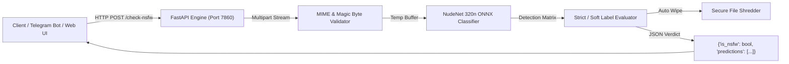

<div align="center">


# 🔞 𝗬𝗨𝗞𝗜 𝗡𝗦𝗙𝗪 𝗔𝗣𝗜 𝗦𝗘𝗥𝗩𝗘𝗥

### ⚡ 𝗛𝗶𝗴𝗵-𝗦𝗽𝗲𝗲𝗱 𝗔𝗜 𝗜𝗺𝗮𝗴𝗲 𝗠𝗼𝗱𝗲𝗿𝗮𝘁𝗶𝗼𝗻 & 𝗡𝘂𝗱𝗲𝗡𝗲𝘁 𝗗𝗲𝘁𝗲𝗰𝘁𝗶𝗼𝗻 𝗘𝗻𝗴𝗶𝗻𝗲

<p>
  
</p>

<p>
  <a href="https://github.com/SUDEEPBOTS/YUKI-NSFW-API/stargazers"></a>
  <a href="https://github.com/SUDEEPBOTS/YUKI-NSFW-API/network/members"></a>
  <a href="https://github.com/SUDEEPBOTS/YUKI-NSFW-API/issues"></a>
  <a href="https://github.com/SUDEEPBOTS/YUKI-NSFW-API/actions/workflows/ci.yml"></a>
</p>

<p>
  
  
  
  
  
</p>

---


</div>

## 🎯 𝗪𝗵𝗮𝘁 𝗶𝘀 𝗬𝗨𝗞𝗜 𝗡𝗦𝗙𝗪 𝗔𝗣𝗜?

**𝗬𝗨𝗞𝗜 𝗡𝗦𝗙𝗪 𝗔𝗣𝗜** is an enterprise-grade, privacy-first local AI computer vision microservice engineered for real-time explicit content detection and image moderation. Powered by **FastAPI**, **Uvicorn**, and **NudeNet ONNX Runtime**, it delivers millisecond-level inference on both CPU and GPU environments without relying on third-party cloud moderation APIs.

Designed specifically for automated Telegram moderation bots, web platforms, and community group security filters.

🔒 **Zero Third-Party Dependency** &bull; **Zero Data Logging** &bull; **Instant In-Memory Purging**

<div align="center">

</div>

## 🏗️ 𝗦𝘆𝘀𝘁𝗲𝗺 𝗔𝗿𝗰𝗵𝗶𝘁𝗲𝗰𝘁𝘂𝗿𝗲



<div align="center">

</div>

## ✨ 𝗙𝗲𝗮𝘁𝘂𝗿𝗲𝘀

<table>
<tr>
<td>

### 🧠 𝗔𝗜 𝗗𝗲𝘁𝗲𝗰𝘁𝗶𝗼𝗻 𝗠𝗮𝘁𝗿𝗶𝘅
- NudeNet 320n ONNX CPU-optimized inference
- Detects exposed body parts, explicit nudity, and suggestive poses
- Granular confidence thresholds (`NSFW_THRESHOLD`)
- Distinguishes strict violations vs warning soft-labels

</td>
<td>

### 🛡️ 𝗣𝗿𝗶𝘃𝗮𝗰𝘆 & 𝗦𝗲𝗰𝘂𝗿𝗶𝘁𝘆
- Automatic instant unlinking of inspected media
- Zero persistence: images never saved to permanent disk or database
- Sanitized environment variable configuration
- Rate-limiting and production WSGI worker clustering

</td>
</tr>
<tr>
<td>

### 🚀 𝗛𝗶𝗴𝗵 𝗣𝗲𝗿𝗳𝗼𝗿𝗺𝗮𝗻𝗰𝗲
- Asynchronous FastAPI non-blocking endpoints
- Multi-worker Uvicorn process manager
- Sub-second classification for standard image payloads
- Native support for JPEG, PNG, WEBP, and GIF frames

</td>
<td>

### 💻 𝗜𝗻𝘁𝗲𝗿𝗮𝗰𝘁𝗶𝘃𝗲 𝗪𝗲𝗯 𝗦𝘁𝘂𝗱𝗶𝗼
- Modern Cyberpunk inspection console (`index.html`)
- Live drag-and-drop image scanning laser simulation
- Bounding box telemetry and raw JSON inspector
- Built-in REST API interactive testing sandbox

</td>
</tr>
</table>

<div align="center">

</div>

## 📡 𝗔𝗣𝗜 𝗘𝗻𝗱𝗽𝗼𝗶𝗻𝘁𝘀

| Method | Endpoint | Description | Auth |
| :--- | :--- | :--- | :--- |
| `POST` | `/check-nsfw` | Upload an image file for full explicit content detection | Optional Token |
| `GET` | `/health` | Server health check and uptime probe | Public |
| `GET` | `/metrics` | Prometheus metrics and worker status | Public |
| `GET` | `/docs` | Interactive Swagger UI API documentation | Public |

### 🔍 Example Request (`curl`)

```bash
curl -X POST "http://localhost:7860/check-nsfw" \
     -H "accept: application/json" \
     -H "Content-Type: multipart/form-data" \
     -F "file=@test_image.jpg"
```

### 📋 Example Response

```json
{
  "is_nsfw": true,
  "status": "DETECTED",
  "score": 0.9824,
  "labels": [
    {
      "class": "FEMALE_BREAST_EXPOSED",
      "score": 0.9824,
      "box": [124, 210, 340, 480]
    }
  ],
  "processing_time_ms": 32.4
}
```

<div align="center">

</div>

## 🚀 𝗗𝗲𝗽𝗹𝗼𝘆𝗺𝗲𝗻𝘁

### ☁️ 𝗢𝗻𝗲-𝗖𝗹𝗶𝗰𝗸 𝗗𝗲𝗽𝗹𝗼𝘆

<p align="left">
  <a href="https://heroku.com/deploy?template=https://github.com/SUDEEPBOTS/YUKI-NSFW-API">
    
  </a>
  &nbsp;
  <a href="https://render.com/deploy?repo=https://github.com/SUDEEPBOTS/YUKI-NSFW-API">
    
  </a>
  &nbsp;
  <a href="https://app.koyeb.com/deploy?type=git&repository=github.com/SUDEEPBOTS/YUKI-NSFW-API&branch=main&name=yuki-nsfw-api">
    
  </a>
</p>

### 🐳 𝗗𝗼𝗰𝗸𝗲𝗿 / 𝗗𝗼𝗰𝗸𝗲𝗿 𝗖𝗼𝗺𝗽𝗼𝘀𝗲

```bash
# Clone the repository
git clone https://github.com/SUDEEPBOTS/YUKI-NSFW-API.git
cd YUKI-NSFW-API

# Launch with Docker Compose
docker compose up -d --build
```

### ⚡ 𝗟𝗼𝗰𝗮𝗹 𝗩𝗣𝗦 𝗤𝘂𝗶𝗰𝗸 𝗦𝗲𝘁𝘂𝗽

```bash
# 1️⃣ Clone the repository
git clone https://github.com/SUDEEPBOTS/YUKI-NSFW-API.git
cd YUKI-NSFW-API

# 2️⃣ Configure environment
cp sample.env .env

# 3️⃣ Install dependencies
pip install -r requirements.txt

# 4️⃣ Run with production script or python
bash nsfw_start.sh
```

<div align="center">

</div>

## ⚙️ 𝗖𝗼𝗻𝗳𝗶𝗴𝘂𝗿𝗮𝘁𝗶𝗼𝗻

Control the strictness and server settings via `.env` or `config.py`:

```env
PORT=7860
WORKERS=2
NSFW_THRESHOLD=0.01
LOG_LEVEL=INFO
```

Strict detection labels configured out of the box:
```python
STRICT_NSFW = {
    "ANUS_EXPOSED",
    "FEMALE_BREAST_EXPOSED",
    "BUTTOCKS_EXPOSED",
    "FEMALE_GENITALIA_EXPOSED",
    "MALE_GENITALIA_EXPOSED",
}
```

<div align="center">

</div>

## 📜 𝗟𝗶𝗰𝗲𝗻𝘀𝗲

Distributed under the MIT License. See [LICENSE](LICENSE) for more information.

---

<div align="center">

### ⭐ 𝗦𝘁𝗮𝗿 𝘁𝗵𝗶𝘀 𝗿𝗲𝗽𝗼 𝗶𝗳 𝘆𝗼𝘂 𝗳𝗼𝘂𝗻𝗱 𝗶𝘁 𝘂𝘀𝗲𝗳𝘂𝗹!

<p>
  
</p>

<a href="https://github.com/SUDEEPBOTS">
  
</a>
<a href="https://t.me/SUDEEPBOTS">
  
</a>

</div>
